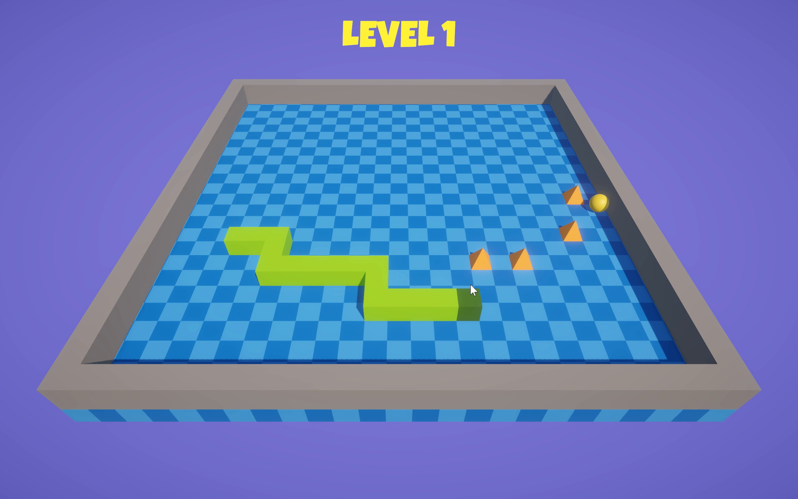
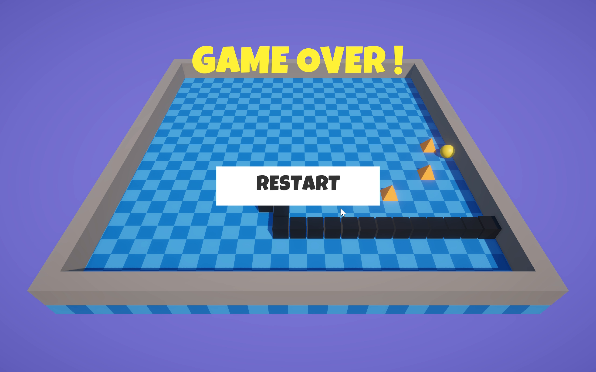

# 3D Snake — Unity

A modern 3D adaptation of the classic Snake game, developed using **Unity 6** and the **Universal Render Pipeline (URP)**.

Navigate your snake through a walled arena, collect food to grow longer, avoid deadly spikes, and survive for as long as possible.

## Gameplay Features

- **Snake Growth:** Collect food to increase the snake's length. One or two food items remain on the board at any time. New food spawns on available tiles when the existing food is collected.
- **Dynamic Hazards:** Spikes are randomly distributed across the arena at the beginning of each run. They never spawn near the player's starting position or underneath food.
- **Collision Detection:** Colliding with a wall, spike, or the snake's own body ends the game.
- **Game Over Animation:** Upon collision, the snake turns black and collapses onto the board.
- **Instant Restart:** Restart the game immediately after a game-over state.

## Controls

| Key | Action |
|---|---|
| W | Move Up |
| S | Move Down |
| A | Move Left |
| D | Move Right |

## Screenshots

**Gameplay — Snake at length 13, navigating between spikes**

**Game Over — Snake collapsing after a collision**

## Technical Overview

The game uses a fully **grid-based movement and collision system**.

The snake's body is represented as a list of integer grid coordinates. Movement, wall collisions, self-collisions, food collection, and spike detection are handled through grid-based calculations.

The gameplay system does not rely on Rigidbodies, colliders, or physics callbacks during normal gameplay. This provides deterministic movement and frame-rate-independent gameplay.

Physics is introduced only when the snake dies, creating the collapse animation.

## Project Structure

All primary game scripts are located in `Assets/Scripts`.

| Script | Description |
|---|---|
| `GameManager` | Manages game states, scoring, and game-over UI. Implements a self-initializing singleton, requiring no manual scene setup. |
| `SnakeMovement` | Handles snake movement, buffered input, reversal prevention, growth, and collision detection. |
| `GenerateFloor` | Generates the checkerboard floor and arena boundaries, and defines the playable grid bounds. |
| `GenerateFood` | Maintains one or two food items on available grid tiles. |
| `GenerateSpike` | Randomly places spike hazards while maintaining a safe zone around the spawn position. |
| `Events` | Handles UI interactions, including restart, menu, and quit actions. |

## Getting Started

### Requirements

- Unity 6 (6000.2 or later)
- Unity Hub
- Universal Render Pipeline (URP)

### Installation

1. Clone or download this repository.
2. Open Unity Hub.
3. Select **Add Project from Disk**.
4. Navigate to the cloned project directory and select it.
5. Open the project using Unity 6000.2 or later.
6. Open `Assets/Scenes/Level.unity`.
7. Press **Play** to start the game.

## Technologies Used

- Unity 6
- C#
- Universal Render Pipeline (URP)
- Grid-based movement and collision detection
- Unity Physics (death animation only)
# 3d-snake-unity
